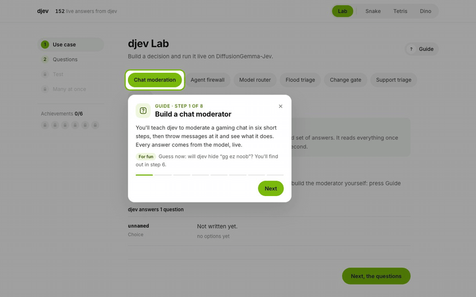
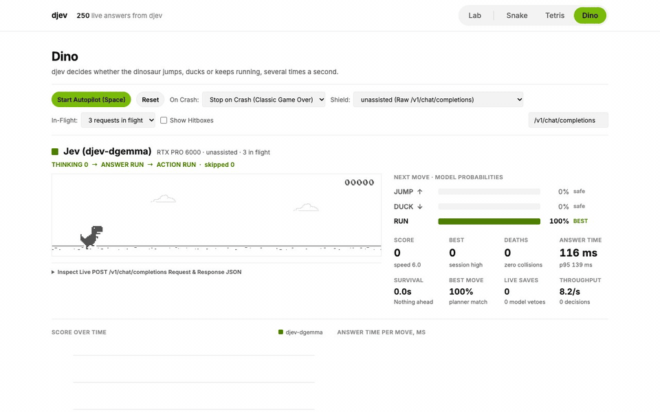
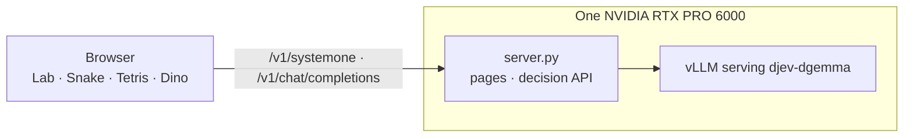

# djev Lab

**Fast typed decisions with DiffusionGemma-Jev, live on a GPU.** Build a decision, test it, watch it moderate a chat, and see it play Snake, Tetris and Dino, with every answer coming straight from the model.



djev answers questions with a fixed set of answers (**Choice**, **Score**, **Yes / No**). It doesn't write text: it reads the input once and returns the probability of every answer, in about **60–80 ms on one RTX PRO 6000**. That suits the decisions a product makes thousands of times a day: routing, gating, triage and moderation.

## What's inside

**djev Lab** walks you through **Use case → Questions → Test → Many at once**. The **Guide** button builds a chat moderator from scratch with you. Other use cases: Agent firewall, Model router, Flood triage, Change gate, Support triage, or a blank one.

**Chat moderation** turns the Test step into a live `#general` channel: **allow** in green, **hide** in amber (blurred), **escalate** in red.


**Many at once** runs up to 100 inputs in parallel and shows decisions per second.


**Three games**, every move decided by djev:

<table>
  <tr>
    <td width="33%"></td>
    <td width="33%"></td>
    <td width="33%"></td>
  </tr>
  <tr>
    <td><b>Snake</b>: each move, with the probability of each direction</td>
    <td><b>Tetris</b>: the placement, plus a read of the board</td>
    <td><b>Dino</b>: jump, duck or run, several times a second</td>
  </tr>
</table>

## Run it

Needs a Linux host with an NVIDIA Blackwell GPU and about 40 GB of free GPU memory (for example an RTX PRO 6000).

```bash
git clone https://github.com/Hrishikesh332/DiffusionGemma-djev-Lab.git djev-lab && cd djev-lab
./deploy.sh
```

`deploy.sh` installs Docker and the NVIDIA toolkit if missing, downloads the pinned weights (18 GB), builds the image, starts it and warms it up. It's safe to run again. Then open `http://<host>:8080/lab`, ideally through your provider's HTTPS proxy.

Settings: `DJEV_PORT` (8080), `DJEV_NAME` (djev), `WEIGHTS_DIR` (./weights), `DJEV_BIND` (0.0.0.0).

**On NVIDIA Brev**, from your laptop:

```bash
brev create djev-run --type massedcompute_RTXPro6000
brev copy ./ djev-run:/home/shadeform/djev-lab/
brev exec djev-run "cd ~/djev-lab && ./deploy.sh" < /dev/null
brev ports open djev-run 8080 --protocol http --public --hostname djev
```

`brev exec` needs `< /dev/null`. The machine bills by the hour until you `brev delete` it.

**On Google Cloud Run:** see [CLOUD_RUN.md](CLOUD_RUN.md). It follows the codelab's recipe and has been dry-run, but not yet deployed end to end.

## How it works



The server writes the question and its allowed answers into a fixed answer canvas. djev reads it in one pass, and the server turns its scores into probabilities. Nothing is stored between requests, so everything a person builds stays in their own browser.

Built on [taeold/djev-run](https://github.com/taeold/djev-run), with these fixes:

- an empty "thinking" section before the answers, which removed 50/50 answers (mean confidence 0.908 → 0.960)
- the game pages call the real model; the upstream pages silently fell back to a simulation
- no simulated fallbacks or placeholder numbers: if the model can't answer, the page shows an error
- Tetris sends readable options (it was sending `[object Object]`)
- every answer carries its vLLM `request_id`, and the nav counts live answers from `/metrics`

## Security and usage log

The link is safe to share with a workshop audience. A gateway in `server.py` (source: `lab/gateway.py`) exposes only what the pages need. It limits request sizes, allows only short diffusion reads (no free chatbot), adds browser security headers and hides internal errors.

Each outside request writes one private `DJEV_AUDIT` line to the server log. The line has a pseudonymous client ID, path, status and size, and never what people type. To see who is using it and flag misuse:

```bash
docker logs djev 2>&1 | grep DJEV_AUDIT | python3 tools/usage_report.py
```

To block a client within 10 seconds, without a restart:

```bash
echo "<client id>" >> blocklist.txt
```

## Performance

Measured with `loadtest/loadtest.py` on the GPU host:

| People at once | Decisions per second | Slowest 5% | Errors |
|---|---|---|---|
| 10 | 72 | 190 ms | 0 |
| 25 | 92 | ~400 ms | 0 |
| 40 | 110 (the limit) | ~500 ms | 0 |

Add your network round trip to the GPU's region, so deploy close to your audience.

## For contributors

| Piece | Pinned to |
|---|---|
| Base image | `ghcr.io/taeold/djev-run@sha256:a352b97a…` (`Dockerfile`) |
| Upstream source | `taeold/djev-run` commit `35a6ff0` (`scripts/rebuild-pages.sh`) |
| Model weights | `nvidia/diffusiongemma-26B-A4B-it-NVFP4` revision `ec4ff3d` (`deploy.sh`) |

The pages and `server.py` in `djev-patched/` are generated. Edit `lab/` or `patch_demos.py`, then run `scripts/rebuild-pages.sh` and `docker compose up -d --build`. To re-record a GIF: `DJEV_URL=https://<your-url> node --experimental-websocket tools/record-gif.mjs <tour|chat|batch|snake|tetris|dino> <out.gif>` (needs Chrome and ffmpeg).

## Credits

- [taeold/djev-run](https://github.com/taeold/djev-run): serving djev on vLLM, and the original demo pages
- [mmastrac/djev](https://github.com/mmastrac/djev): Jev-style structured decisions on DiffusionGemma
- [nvidia/diffusiongemma-26B-A4B-it-NVFP4](https://huggingface.co/nvidia/diffusiongemma-26B-A4B-it-NVFP4): the model weights
- [trungdq88/jev-tetris](https://github.com/trungdq88/jev-tetris): the Tetris engine
- [virajbhartiya/laya-vs-jev](https://github.com/virajbhartiya/laya-vs-jev): the Dino game, its T-Rex engine and safety planner
- Google codelab [Getting started with Discriminative models](https://codelabs.developers.google.com/codelabs/discriminative-models): the workshop and its Cloud Run recipe
